# psutop

A live, nvtop-style terminal monitor for the **per-wire current of the 12V-2x6 GPU power
cables** on MSI MPG Ai1600TS and Ai1300TS power supplies, on Linux.

These PSUs measure the current on each of the six +12 V wires of both GPU connectors and
cut power when one runs too hot (MSI calls it GPU Safeguard+). MSI only shows this data on
Windows. psutop reads it over the PSU's USB link, read-only, so an overloaded or unevenly
loaded wire shows up before the PSU has to act. It reads nothing but the PSU: it works the
same with NVIDIA, AMD or Intel GPUs and needs no GPU driver or tool.



*The built-in simulator (`psutop --sim cycle`), rendered by `cargo run --example demo_svg`.*

> **psutop is a monitor, not a protection device.** Only the PSU cuts power. The alert
> limits are MeltAlarm's engineering defaults, not safety ratings. psutop is not
> affiliated with MSI.

## Features

- Six cut bars per cable on MeltAlarm's knee scale: the top of a bar is the alarm limit,
  the cut is the 9.5 A contact rating. Colour appears only for Caution and ALARM.
- MeltAlarm's alert rules, unchanged: a wire above its rating, overload episodes, uneven
  load, and the PSU's own verdict with its power-cut countdown.
- A label per cable for what it powers (`GPU 0` / `GPU 1` by default).
- A history chart with each cable's watts and its hottest wire, a raw-frame pane, and an
  optional CSV log.
- `once` and `watch` modes for SSH and scripts, with stable JSON and CSV output.
- A simulator (`--sim`) that runs anywhere, macOS included, to try it without the hardware.

## Supported hardware

| PSU | USB ID | Status |
|---|---|---|
| MSI MPG Ai1600TS | `0db0:808c` | Verified on Linux |
| MSI MPG Ai1300TS | `0db0:aa6f` | Same protocol (verified by MeltAlarm on Windows); untested on Linux |

The PSU's USB cable must be connected to a motherboard USB 2.0 header. Any GPUs work: psutop
reads only the PSU.

## Help wanted: more PSUs

psutop's goal is to support **every PSU that measures the current on each wire of its GPU
cables**, not just MSI's. That needs people who own those PSUs. Two ways to help:

- **Test a PSU.** Own an MSI MPG Ai1300TS? It has never been run on Linux. Run psutop, compare
  its readings with the vendor's app or a clamp meter, and send a
  [PSU test report](https://github.com/ImtyOSS/psutop/issues/new?template=psu-report.yml).
  The same goes for any new driver waiting on hardware. No coding needed.
- **Add a PSU.** If your PSU's own app shows a current for each 12V-2x6 wire, psutop can learn
  to read it. [CONTRIBUTING.md](CONTRIBUTING.md) walks through it: capturing the vendor app's
  USB traffic, writing a read-only driver, connecting it to psutop and testing it. Start with a
  [New PSU](https://github.com/ImtyOSS/psutop/issues/new?template=new-psu.yml) issue.

Every driver follows the same rule as the MSI one: it sends only the read requests the vendor's
own software sends, and nothing that could change a setting.

## Tested on

| Where | What was checked | Date |
|---|---|---|
| Ubuntu 26.04 LTS, kernel 7.0, x86_64, MSI MPG Ai1600TS (firmware 10), two GPUs | Full hardware checklist: permissions, values identical to an independent reader, 10-minute soak at 0.1% CPU, two readers at once, `--trace-io` read-only proof | 2026-10-15 |
| macOS 26 (Apple silicon) | Simulator, all layouts, test suite | 2026-10-15 |
| Ubuntu 24.04 and the latest macOS (GitHub Actions) | Build, tests and lints on every push | — |

Other distributions with systemd (Debian, Fedora, Arch, …) should work the same way but
haven't been tried yet. Reports are welcome, with your distro, kernel, PSU and firmware
(`psutop info`).

## Quick start

Try it without hardware, on Linux or macOS, with [Rust](https://rustup.rs) 1.89 or newer:

```bash
cargo run --release -- --sim cycle
```

On the machine with the PSU, follow **[docs/SETUP.md](docs/SETUP.md)**. In short: build, then
run `sudo psutop`. To skip `sudo` at the machine itself, install the included udev rule once.
`psutop doctor` checks the setup and tells you what's missing.

## Usage

```text
psutop                     full-screen monitor
psutop once [--json]       one sample, then exit
psutop watch [--live] [--csv | --json] [--count N]
                               stream samples (card lines on a terminal, plain when piped)
psutop info                PSU identity, firmware, Safeguard+ settings, cable labels
psutop doctor              check the setup (USB, device, udev rule, group, access) and print fixes

Global options: --interval 1s (500ms–2s)  --config <path>  --raw  --no-color  --nerd-font
                --bell  --trace-io  --sim <scenario> (--sim list)
```

Keys: `F1`/`?` help · `F3`/`r` raw frames · `F5`/`p` pause ·
`F6`/`←` `→` chart window · `F9`/`l` CSV log · `1`/`2` zoom a cable (`c` clears its
peaks) · `F10`/`q`/`Esc` quit.

Exit codes for `once`, `watch` and `info`: `0` OK, `2` PSU not found, `3` permission
denied, `4` PSU not answering. `doctor` exits `1` if any check fails.

The config file is `~/.config/psutop/config.toml`. Without it, cable 1 is labelled `GPU 0`
and cable 2 `GPU 1`; to find out which is which, load one GPU and watch which cable's watts
rise. The alert limits can be overridden too:

```toml
[cables.1]
label = "RTX 4090"   # shown on the card and in the chart

[cables.2]
label = "RX 7900 XTX"

[limits]             # optional; MeltAlarm's defaults otherwise
rating = 9.5
```

## How it works

- **Built on MeltAlarm's code.** The data model, every level and alarm decision, the status
  texts and the MSI protocol come from MeltAlarm's crates, copied into
  [third_party/meltalarm](third_party/meltalarm) and maintained there as part of psutop.
  Nothing is fetched from MeltAlarm at build time.
- **Read-only.** The PSU code can send only a fixed allowlist of read requests and MSI's
  connect handshake, through a single reviewed write call; a test and a clippy lint keep it
  that way. `--trace-io` prints every packet so you can check.
- **Raw frames.** A small hook added to the copy of MeltAlarm's PSU crate (proposed upstream in
  [docs/upstream](docs/upstream)) exposes the raw replies. psutop decodes the PSU's rail
  currents, rail volts and output watts from them; those values are *inferred* and labelled
  that way.
- **Sharing the PSU.** Each poll takes `flock` on `/run/lock/msi-psu.lock`, so readers on
  one machine don't interleave requests.

[SPEC.md](SPEC.md) is the full design: look and feel, alert rules, protocol notes, and the
hardware checks a release has to pass.

## Development

```bash
cargo test                      # any platform: simulator, UI snapshots, decoders
cargo test --workspace          # Linux: also the copied MeltAlarm crates and the allowlist test
cargo clippy --workspace --all-targets
```

UI changes show up as [insta](https://insta.rs) snapshot diffs in `tests/snapshots`; review
them, then accept with `INSTA_UPDATE=always cargo test`. After a visible change, regenerate the
README animation with `cargo run --example demo_svg -- docs/demo.svg`. CI runs both platforms.

Design choices worth knowing:

- `meltalarm-runtime` is not used: its tick is fixed at 1 s and it writes MeltAlarm's own
  settings files. psutop drives `meltalarm-core` from its own acquisition thread.
- `meltalarm-source-sim` is not used: it cannot build on macOS. psutop's simulator
  reuses its wire values and simulates both cables, the GPUs and the raw frames.
- Bars have flat ends and eighth-block fills; quadrant "rounded" caps render as steps in
  real terminals.
- The caution strip shows MeltAlarm's 10 s strip, then keeps a short line while the caution
  lasts, so a monitor left open still says why a card is amber.

## Security

[SECURITY.md](SECURITY.md) covers what psutop touches on your machine, why the PSU gets
its own group, and how to report a problem.

## Credits

psutop stands on **[MeltAlarm](https://github.com/DeniDoman/meltalarm)** by Denis
Domanskii (MIT License, © 2026), copied at commit `7763086` (v0.3.9):

- **Code:** the `meltalarm-model`, `meltalarm-core`, `meltalarm-source-api` and
  `meltalarm-source-msi` crates provide the data model, every level, alarm rule and status
  text, and the read-only MSI PSU protocol. psutop keeps its own copies in
  [third_party/meltalarm](third_party/meltalarm); each file names its origin, and what
  changed (a raw-frame hook, texts that named the Windows app) is listed there.
- **Protocol knowledge:** the registers, frame layout, LINEAR11 decoding and connect
  handshake are MeltAlarm's work, which it took from MSI Center.
- **Design:** the cable card, cut bars, knee scale, palette and state words follow
  MeltAlarm's `docs/DESIGN.md`; its reference screenshots are in
  [docs/reference](docs/reference).
- **Simulator values:** the wire arrays come from `meltalarm-source-sim`.

MeltAlarm's licence notice is kept in [third_party/meltalarm/LICENSE](third_party/meltalarm/LICENSE)
and [docs/reference/LICENSE-meltalarm](docs/reference/LICENSE-meltalarm).

The full-screen layout, header meters and chart style are modelled on
[nvtop](https://github.com/Syllo/nvtop); no nvtop code is used.

## License

psutop is released under the [MIT License](LICENSE). The MeltAlarm code it copies is
MIT-licensed as well; its notice is kept as described under Credits.
